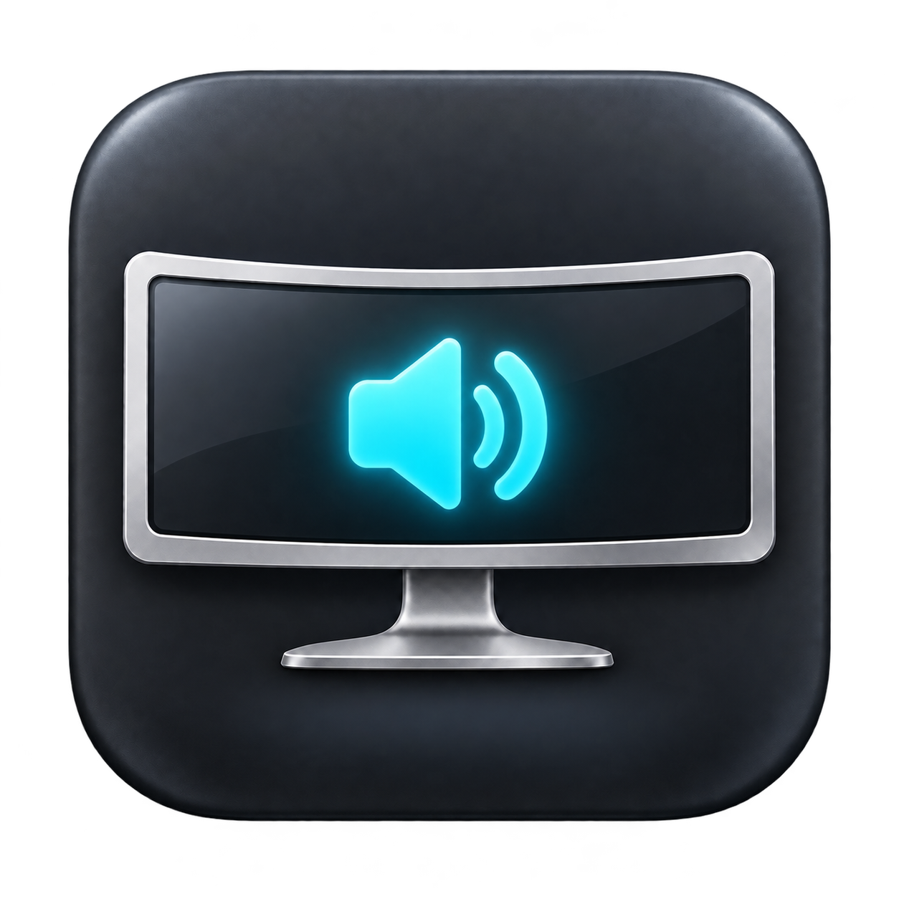

<p align="center"></p>
<h1 align="center">LG Sound</h1>
<p align="center">Your monitor speakers. Your Mac’s volume controls.</p>
<p align="center">
  <a href="https://github.com/pelipas31/lg-sound/releases/latest">Download</a> ·
  <a href="README.ru.md">Русский</a> ·
  <a href="https://github.com/pelipas31/lg-sound/issues">Report an issue</a>
</p>
<p align="center">
  
  
  <a href="LICENSE"></a>
</p>

LG Sound is a small, free menu bar app that controls the hardware speaker volume of an LG ULTRAGEAR+ monitor over USB-C / DisplayPort. Use its slider, your keyboard’s media keys, or a volume knob that sends standard media commands.

It started with a simple annoyance: an LG monitor connected to an M3 Mac played audio, but macOS’s volume controls were unavailable. LG Sound sends volume commands directly to the monitor using [m1ddc](https://github.com/waydabber/m1ddc).

## Features

- Menu bar volume slider and percentage.
- Volume up/down and mute from standard media keys, including a tested Keychron knob.
- Mute and restore the previous level from the menu.
- Media keys control LG only while it is the default audio output; the slider always targets LG.
- Optional launch at login and automatic connection checks after wake/disconnect.
- English and Russian interface, chosen by macOS language preferences.
- Local operation, no account, analytics, or app network requests.

The native macOS volume slider stays unavailable for the DisplayPort output. LG Sound provides its own slider and controls the monitor’s hardware volume. It does not install an audio driver or modify the audio stream.

## Compatibility

| Requirement | Status |
| --- | --- |
| Mac | Apple Silicon; arm64 build only |
| macOS | 13+ build target; older releases have not been hardware-tested |
| Monitor | Currently targets the display/audio name `LG ULTRAGEAR+` |
| Connection | USB-C / DisplayPort with working DDC/CI volume commands |
| Tested setup | LG 52G930B / `LG ULTRAGEAR+`, M3 Pro, macOS 27, USB-C / DisplayPort, Keychron volume knob |

Other LG models, HDMI, docks, Intel Macs, and nonstandard knob mappings are unverified. DDC/CI support varies by monitor and connection. When multiple matching monitors are connected, the first is selected. There is no monitor picker yet.

## Install

1. Download `LG-Sound-1.0.0-arm64.zip` from [Releases](https://github.com/pelipas31/lg-sound/releases/latest) and unzip it.
2. Move **LG Sound.app** into **Applications** before opening it.
3. This community build is **ad-hoc signed and not notarized**. If macOS blocks it, review the source or build it yourself. If you choose to trust the downloaded build, Apple documents the app-specific **Privacy & Security → Open Anyway** flow [here](https://support.apple.com/en-gb/102445).
4. Select **LG ULTRAGEAR+** in **System Settings → Sound → Output**.
5. Use the speaker icon in the menu bar. The slider does not need Accessibility access.
6. For keys or a knob, choose **Enable volume keys…**, then enable **LG Sound** in **Privacy & Security → Accessibility**. Restart the app if macOS requests it.

Downloads include `SHA256SUMS.txt`. Compare the archive’s SHA-256 hash with `shasum -a 256 LG-Sound-1.0.0-arm64.zip`.

### Keys or knob do nothing

Check that the slider works and LG is the selected audio output. Then check Accessibility access.

**After an update or rebuild, the Accessibility switch can appear on while the current app is denied.** Remove LG Sound from Accessibility with **−**, add the current app from Applications with **+**, enable it, and restart. Local ad-hoc signatures are tied to a specific build; [Apple explains code identity here](https://developer.apple.com/documentation/technotes/tn3127-inside-code-signing-requirements).

The knob must send standard volume up/down or mute commands. Custom VIA/QMK mappings may need adjustment. Other apps that intercept media keys can conflict.

### Monitor does not respond

Enable DDC/CI in the monitor’s on-screen menu if available, try a direct USB-C / DisplayPort connection, and choose **Reconnect monitor**. Hardware volume is polled every eight seconds, so changes made with the monitor joystick may appear after a short delay.

## Build from source

Install Apple Command Line Tools if needed (`xcode-select --install`), then:

```sh
git clone https://github.com/pelipas31/lg-sound.git
cd lg-sound
./build.sh
```

The result is `build/LG Sound.app`. Copy it to Applications yourself. Building does **not** replace an installed app. Homebrew, the full Xcode IDE, and a separate m1ddc installation are not required.

Create the release ZIP and checksum with `./scripts/package.sh`. Regenerate the macOS `.icns` file from the PNG with `./scripts/make-icon.sh`.

The bundled m1ddc helper is compiled locally from the pinned source in `Vendor/m1ddc` and included with its MIT license. GitHub Actions builds and checks the app signature; physical keyboard/monitor tests require hardware.

## Privacy and permissions

Accessibility access lets LG Sound intercept standard volume media commands. The app does not record typed text or audio. A local file at `~/Library/Application Support/LG Sound/status.json` contains the audio output name, display identifier, volume, permission/tap state, and last volume media event. It is not uploaded. Review device names and identifiers before sharing diagnostics.

To uninstall, quit the app, disable its optional login item, remove it from Applications and Accessibility, and optionally delete its `LG Sound` folder inside `~/Library/Application Support`.

## Contribute and license

See [CONTRIBUTING.md](CONTRIBUTING.md). English and Russian bug reports are welcome.

MIT licensed. Built with [m1ddc](https://github.com/waydabber/m1ddc); see [third-party notices](THIRD_PARTY_NOTICES.md). Independent community project, not affiliated with LG Electronics, Apple, or Keychron.
