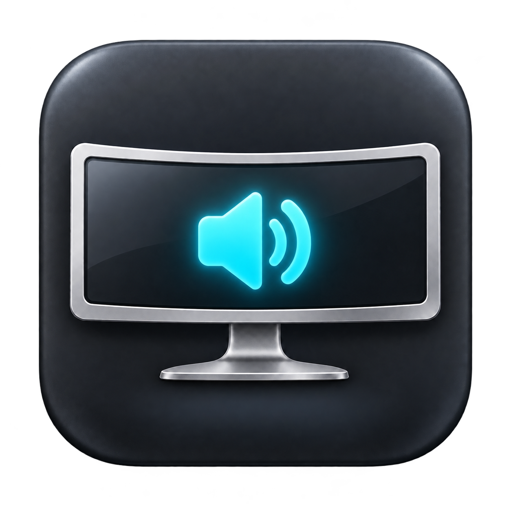

<p align="center"></p>
<h1 align="center">LG Sound</h1>
<p align="center">Громкость и яркость монитора — под твоим управлением.</p>
<p align="center">
  <a href="https://github.com/pelipas31/lg-sound/releases/latest">Скачать</a> ·
  <a href="README.md">English</a> ·
  <a href="https://github.com/pelipas31/lg-sound/issues">Сообщить об ошибке</a>
</p>

LG Sound — небольшая бесплатная утилита в строке меню macOS для управления аппаратной громкостью и яркостью LG ULTRAGEAR+ по USB-C / DisplayPort. Меняй громкость и яркость ползунками; для звука также работают медиаклавиши и совместимая крутилка.

Проект появился из простой проблемы: LG подключён к Mac M3, звук есть, а macOS не даёт менять громкость. LG Sound отправляет команды прямо монитору через [m1ddc](https://github.com/waydabber/m1ddc).

## Возможности

- Ползунок и процент громкости в строке меню.
- Аппаратная яркость в меню и отдельном окне, с проверкой фактического значения на мониторе.
- Отдельное окно управления: открой LG Sound из «Программ», даже если значок скрыт.
- Клавиши громкости и mute; проверена работа с крутилкой Keychron.
- Выключение звука и восстановление прежнего уровня через меню.
- Клавиши управляют LG, только когда он выбран аудиовыходом; ползунок всегда управляет LG.
- Необязательный автозапуск и повторные проверки подключения после сна и отключения кабеля.
- Автоматическое переподключение крутилки при смене аудиовыхода и проверка отключённого или недействительного перехвата.
- Реальное состояние клавиш в окне и команда «Переподключить клавиши».
- Интерфейс на русском и английском в зависимости от языковых настроек macOS.
- Работа локально, без аккаунта, аналитики и сетевых запросов приложения.

Штатные ползунки macOS могут оставаться недоступными для внешнего DisplayPort-устройства. У LG Sound свои ползунки аппаратной громкости и яркости. Утилита не устанавливает аудиодрайвер, не обрабатывает звуковой поток и не имитирует яркость затемняющим слоем. Клавиши яркости не перехватываются.

## Совместимость

| Требование | Статус |
| --- | --- |
| Mac | Apple Silicon, сборка только arm64 |
| macOS | Целевая версия сборки — 13+; старые версии на реальном оборудовании не проверены |
| Монитор | Сейчас используется имя дисплея и аудиовыхода `LG ULTRAGEAR+` |
| Подключение | USB-C / DisplayPort с поддержкой команд громкости DDC/CI; для яркости нужен DDC/CI luminance |
| Проверенная связка | LG 52G930B / `LG ULTRAGEAR+`, M3 Pro, macOS 27, USB-C / DisplayPort, крутилка Keychron |

Другие LG, HDMI, доки, Intel Mac и нестандартные команды крутилки не проверены. Поддержка DDC/CI зависит от монитора и подключения. Если подходящих мониторов несколько, выбирается первый. Выбора монитора в интерфейсе пока нет.

## Установка

1. Скачай `LG-Sound-1.1.1-arm64.zip` из [Releases](https://github.com/pelipas31/lg-sound/releases/latest) и распакуй.
2. Перенеси **LG Sound.app** в **Программы** перед первым запуском.
3. Начиная с 1.1.1 релизные сборки **подписаны Developer ID, но пока не нотарифицированы Apple**. Артефакты GitHub Actions и исходники без настроенного сертификата собираются с временной ad-hoc подписью. Если macOS её блокирует, можно изучить исходники или собрать приложение самостоятельно. Если доверяешь скачанной сборке, у Apple есть [инструкция по открытию конкретного приложения](https://support.apple.com/en-gb/102445) через **Конфиденциальность и безопасность → Всё равно открыть**.
4. В **Системные настройки → Звук → Выход** выбери **LG ULTRAGEAR+**.
5. Открой иконку динамика в строке меню. Оба ползунка работают без дополнительных разрешений.
6. Для клавиш или крутилки выбери **Разрешить клавиши громкости…** и включи **LG Sound** в **Конфиденциальность и безопасность → Универсальный доступ**. Перезапусти утилиту, если этого попросит macOS.

В релизе есть `SHA256SUMS.txt`. Для сравнения контрольной суммы выполни `shasum -a 256 LG-Sound-1.1.1-arm64.zip` рядом со скачанным архивом.

### Яркость недоступна или ограничена

Используется аппаратная команда DDC/CI luminance. Если монитор не сообщает яркость, её ползунок отключается, а громкость остаётся доступной. Если монитор ограничивает изменение, приложение показывает фактическое значение и сообщение. Проверь HDR, автоматическую яркость и режим изображения в меню монитора. Изменения джойстиком монитора считываются при очередном опросе — примерно раз в восемь секунд.

### Пропал значок в строке меню

Открой **LG Sound.app** из «Программ»: появится окно управления, а утилита повторно запросит показ значка. В новых macOS также проверь **Системные настройки → Строка меню → Разрешить в строке меню**. Внутренний флаг видимости приложения может быть включён, хотя macOS скрывает значок.

В 1.0.1 используется публичный идентификатор `io.github.pelipas31.LGSound` и отдельное имя элемента строки меню. На Mac разработчика установка этой сборки в `/Applications` вернула значок, который оставался скрытым у старой установки. Это проверенный случай восстановления на одном Mac, а не гарантия решения всех ошибок строки меню macOS.

При обновлении с 1.0.0 выйди из старой копии и замени её в «Программах». Удали старую запись «Универсального доступа» и разреши новую копию. При необходимости заново включи автозапуск. Ползунок окна работает и без разрешения на клавиши.

### Клавиши или крутилка не работают

Окно показывает реальное состояние: клавиши подключены, ожидают выбора LG, переподключаются или не получили разрешение. Проверь, выбран ли LG аудиовыходом. Если доступ есть, а клавиши не работают, нажми «Переподключить клавиши». Смена выхода и пробуждение переподключают перехват автоматически; его работоспособность проверяется каждую секунду.

**При переходе со старой временной подписи переключатель может быть включён, хотя текущая версия не получила доступ.** Удали LG Sound из списка кнопкой **−**, добавь актуальный `/Applications/LG Sound.app` через **+** и включи доступ. С 1.1.1 релиз подписан Developer ID: постоянный издатель и идентификатор позволяют сохранять разрешение при следующих обновлениях. Перезапусти приложение, если этого попросит macOS. Сборки из исходников и CI с ad-hoc подписью всё ещё меняют идентичность при пересборке; механизм описан в [документации Apple](https://developer.apple.com/documentation/technotes/tn3127-inside-code-signing-requirements).

Крутилка должна отправлять обычные медиакоманды громкости или mute. При нестандартной раскладке VIA/QMK может потребоваться переназначение. Другие приложения, перехватывающие медиаклавиши, могут конфликтовать с LG Sound.

### Монитор не отвечает

Включи DDC/CI в экранном меню монитора, если такая настройка есть, проверь прямое подключение по USB-C / DisplayPort и выбери **Обновить подключение**. Утилита считывает аппаратную громкость раз в восемь секунд: изменения джойстиком монитора могут отображаться с задержкой.

## Сборка из исходников

При необходимости установи Apple Command Line Tools (`xcode-select --install`), затем:

```sh
git clone https://github.com/pelipas31/lg-sound.git
cd lg-sound
./build.sh
```

Готовое приложение: `build/LG Sound.app`. Перенеси его в «Программы» самостоятельно. Сборка **не заменяет** установленную копию. Homebrew, полный Xcode и отдельно установленный m1ddc не нужны.

Регрессионные проверки перехвата: `./scripts/test.sh`. Проверяются смена наушников и монитора, изменение ID устройства, сон, отключённый/недействительный перехват, отказы создания и изменения разрешений. Эти тесты не переключают реальные аудиоустройства.

Для постоянной подписи локальной сборки укажи свой сертификат в `CODE_SIGN_IDENTITY` или запиши его имя/отпечаток в игнорируемый файл `.signing-identity`. Без настройки используется ad-hoc подпись. Для Developer ID включены Hardened Runtime и временная метка Apple; нотарификация выполняется отдельно.

ZIP и контрольная сумма: `./scripts/package.sh`. Пересоздание `.icns` из PNG-иконки: `./scripts/make-icon.sh`.

Помощник m1ddc собирается локально из зафиксированных исходников в `Vendor/m1ddc` и включается в приложение вместе с MIT-лицензией. GitHub Actions проверяет сборку и подпись. Проверка монитора и клавиатуры требует реального оборудования.

## Приватность и разрешения

«Универсальный доступ» нужен для перехвата медиакоманд громкости. Приложение не записывает набираемый текст и звук. Локальный файл `~/Library/Application Support/LG Sound/status.json` содержит имя аудиовыхода, идентификатор дисплея, громкость, яркость и её состояние ошибки, состояние разрешения и перехвата, счётчики переподключений, ID аудиоустройства, статус наблюдателя аудиовыхода и последнюю медиакоманду громкости. Файл никуда не отправляется. Перед публикацией диагностики проверь имена устройств и идентификаторы.

Для удаления выйди из утилиты, отключи её автозапуск, убери приложение из «Программ» и «Универсального доступа». При желании удали его папку `LG Sound` в `~/Library/Application Support`.

## Участие и лицензия

Ошибки и предложения можно писать на русском или английском. Подробности — в [CONTRIBUTING.md](CONTRIBUTING.md).

Лицензия MIT. Используется [m1ddc](https://github.com/waydabber/m1ddc); см. [сторонние компоненты](THIRD_PARTY_NOTICES.md). Независимый проект, не связанный с LG Electronics, Apple или Keychron.
